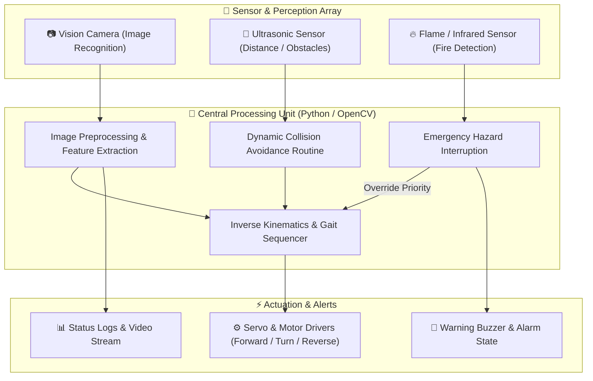

<div align="center">

# 🐕 Robot-Dog — Autonomous Vision & Multi-Sensor Quadruped System

[](https://www.python.org/)
[](https://opencv.org/)
[](#)
[](#)

<p align="center">
  <b>An intelligent, vision-guided autonomous robotic platform integrating Computer Vision and real-time sensory environmental hazard detection.</b>
  <br />
  Equipped with real-time Image Recognition, Ultrasonic Obstacle Avoidance, and Flame/Fire Detection safety protocols.
</p>

---

</div>

## 📌 Project Overview

**Robot-Dog** represents an applied exploration into embedded robotics and machine vision. By combining optical camera streams with sensory feedback (ultrasonic distance and flame detection), the robot can autonomously perceive its surroundings, navigate dynamic obstacles, and react to emergency fire hazards.

---

## 🤖 2D/3D Perception & Control Architecture



---

## 🔬 Core Capabilities

### 1. 📷 Real-time Image Recognition
- Frame capture and real-time object/target identification using image processing techniques.
- Boundary box computation and tracking of designated markers or target targets.

### 2. 📡 Ultrasonic Obstacle Avoidance
- Real-time time-of-flight distance calculation ($Distance = \frac{Time \times SpeedOfSound}{2}$).
- Dynamic path adjustment: Slows down on detection within warning threshold (< 30 cm) and executes 90° avoidance sweep if blocked (< 15 cm).

### 3. 🔥 Flame Detection & Safety Interlock
- Active monitoring via analog/digital flame sensors sensitive to infrared flame spectrum (760 nm – 1100 nm).
- Hardware-interrupt driven failsafe: halts navigation immediately and triggers alert signaling upon thermal spike detection.

---

## 📂 Repository Contents

```plaintext
Robot-Dog/
├── 📁 Img Recognization/                 # Computer vision scripts, weights, and detection pipelines
├── 📄 Obstacle Avoid & Fire Sensor.txt   # Hardware pinouts, sensor calibration code, and control logic
└── 📄 README.md                          # Comprehensive technical documentation
```

---

## 🛠️ Hardware Requirements & Software Stack

- **Microcontroller / SBC**: Raspberry Pi 4 / Arduino Mega or Uno
- **Camera Module**: USB Webcam / Raspberry Pi Camera Module V2
- **Sensors**: HC-SR04 Ultrasonic Sensor, Flame Sensor Module (KY-026 / analogue flame sensor)
- **Motor Control**: L298N Motor Driver / Multi-channel PWM Servo Driver
- **Libraries**: `opencv-python`, `numpy`, `RPi.GPIO` (or `pySerial`)

---

## 👨‍💻 Author

**Momin Rifat**  
- GitHub: [@MominRifat](https://github.com/MominRifat)  
- Location: Dhaka, Bangladesh
